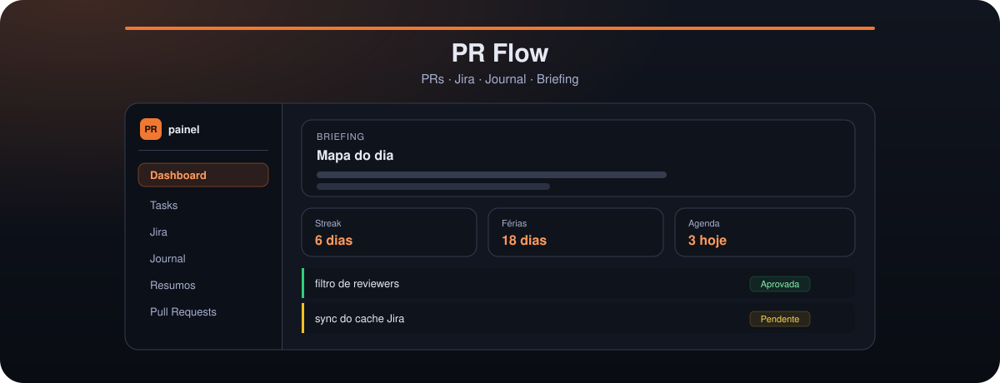
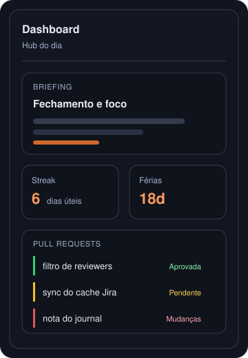

<div align="center">



<br>


<br>

Hub local do dia de trabalho: PRs no GitHub, Jira, journal, tarefas e briefing com IA.

</div>

Pensado para quem joga vários repositórios, revisores e tickets ao mesmo tempo e quer um painel próprio, sem depender de dashboards genéricos.

**App:** [http://localhost:3847](http://localhost:3847)

## Hub do dia

<table>
<tr>
<td width="340" valign="top">

</td>
<td valign="top">
O <code>/dashboard</code> abre o dia já montado.
<ul>
<li><b>Briefing horário</b> — fechamento do último dia útil, desbloqueios e foco, gerado com Gemini</li>
<li><b>Agenda</b> — compromissos de hoje via feed iCal secreto do Google Calendar</li>
<li><b>Streak do journal</b> — dias úteis com nota; sábado e domingo não quebram a sequência</li>
<li><b>Countdown de férias</b> — data no <code>localStorage</code>, no dashboard e na sidebar (alterna com o clima)</li>
<li><b>Deck de atalhos</b> — links pessoais com ícone, cor e ordem definidos por você</li>
</ul>
</td>
</tr>
</table>

## O que entra no painel

| Área | O que você ganha |
|------|------------------|
| **PRs** | Suas PRs abertas, fila de reviews e wizard para abrir PR a partir de branches |
| **Jira** | Tickets atribuídos a você, com sync automático e branch sugerida por IA |
| **Tasks e Journal** | Tarefas locais e uma nota markdown por dia (notebook day) |
| **Resumos** | Diário (Feedback 3×3) e semanal (Bússola de Tendência), à meia-noite |
| **Slack** | Compartilhar uma PR no canal do time |
| **Devtools** | Crons sob demanda, repositórios monitorados e o Portainer do stack Jusfy |

### Pull requests (`/prs`, `/prs/reviews`, `/prs/open`)

- Só PRs **abertas** do usuário autenticado no GitHub
- Universo de reviewers = `requested_reviewers`; “avaliou” = qualquer review (`COMMENTED`, `APPROVED`, `CHANGES_REQUESTED`); o último review da pessoa vence
- PR sem reviewers continua visível, com indicador explícito
- Sync por cron e refresh manual
- **Revisão local:** a cada 15 minutos, uma PR com commit novo é revisada no clone local pelo Claude Code (Haiku e subagentes). O resultado aparece no card. A IA não aprova nem rejeita no GitHub
- **Abrir PR:** descobre branches suas, sugere a base, monta título e corpo (IA opcional) e cria via `gh`

### Jira, journal e resumos

- Cache Jira a cada ~10 min; chaves `JOR-xxx` viram link no markdown
- **Criar branch com IA:** repos monitorados → slug `feat/` ou `fix/` → refs remotas no GitHub
- Uma nota markdown ativa por dia (soft-delete, corpo obrigatório); o calendário marca os dias que já têm nota
- Resumos usam o notebook day (journal + tasks + Jira + PRs). Se o app estava offline à meia-noite, o boot gera até 14 dias pendentes
- Tom dos resumos: `SUMMARY_CAREER_LEVEL` (`junior`, `pleno` ou `senior`)

## Startup rápido

Pré-requisitos: **Node.js 22** e **GitHub CLI** (`gh`). O banco é o SQLite embutido do Node (`NODE_OPTIONS=--experimental-sqlite`, já ligado nos scripts npm). A revisão local também precisa do **Claude Code** no PATH, autenticado pela assinatura (`claude` ou `claude setup-token`). Não defina `ANTHROPIC_API_KEY` nesse processo.

```bash
npm install
cp .env.example .env
# edite GH_TOKEN, MONITORED_REPOSITORIES e o restante
npm run db:migrate
npm run dev                  # http://localhost:3847
```

`npm run dev` aplica as migrations na primeira conexão. GitHub no host: `GH_TOKEN` no `.env` ou `gh auth login`.

Se você já tem dados no Postgres deste app:

```bash
# o Postgres antigo precisa responder em localhost:5432
npm run db:import-postgres      # copia para data/pr-flow.sqlite e ajusta o .env
```

Produção local: `npm run build` e depois `npm run start`. Esse comando aponta o banco para `data/pr-flow.sqlite`. Não use `next start` direto — rotas como `/api/prs/slack-share` quebram.

## Docker

O Compose sobe só o app, com o SQLite em `./data`. A revisão local fica desligada no container (`DISABLE_PR_LOCAL_REVIEW_CRON=1`), porque o Claude Code está no host. Ela roda com `npm run dev` ou `npm run start`.

Pré-requisitos: **Docker** e **Docker Compose**. Token GitHub: [Como obter o GH_TOKEN](#como-obter-o-gh_token).

### 1. Instalar

```bash
./scripts/install.sh   # ou: npm run install:docker
```

O wizard pede GitHub, Gemini, Jira, Calendar e Slack (com o link de cada credencial), valida o essencial, grava o `.env` e faz `docker compose build`.

**Manual:**

```bash
cp .env.example .env
# edite GH_TOKEN e MONITORED_REPOSITORIES
```

Se você já usa `gh auth login` no host:

```bash
gh auth status
./scripts/sync-gh-env.sh   # copia o token para o .env
```

### 2. Subir

```bash
docker compose up --build
# ou em segundo plano:
docker compose up -d --build
```

Na primeira execução: build da imagem, migrations do SQLite em `./data` e start do app. A porta **3847** evita conflito com outros serviços na 3000.

| Serviço | URL |
|---------|-----|
| **PR Flow** | [http://localhost:3847](http://localhost:3847) |

```bash
docker compose logs -f app   # logs do app
docker compose down           # parar; o SQLite em ./data permanece
```

No container os logs saem em JSON Lines (`LOG_FORMAT=json`). Em `npm run dev`, o padrão é texto legível (`LOG_FORMAT=pretty` se quiser forçar).

## Comandos npm

| Comando | Uso |
|---------|-----|
| `npm run install:docker` | Wizard `.env` + `docker compose build` |
| `npm run gh:sync-env` | Copia `gh auth token` para o `.env` |
| `npm run dev` | Dev server na porta 3847 |
| `npm test` | Testes (Vitest) |
| `npm run test:watch` | Testes em watch |
| `npm run build` | Build de produção |
| `npm run start` | Produção local (standalone; requer build) |
| `npm run db:migrate` | Aplica migrations no SQLite |
| `npm run db:import-postgres` | Copia os dados do Postgres antigo para o SQLite |
| `npm run db:generate` | Gera migration a partir do schema |

## Módulos e rotas

Código por domínio em `modules/`. Rotas em `app/(shell)/` e `app/api/`. `/` redireciona para `/dashboard`.

| Módulo | Responsabilidade |
|--------|------------------|
| `dashboard` | Hub, widgets e briefing |
| `prs` | Monitor, reviews, abrir PR, sync GitHub, Slack |
| `jira` | UI e sync de tickets atribuídos |
| `jira-branch` | Wizard de criação de branch com IA |
| `jira-issue-key` | Chaves Jira e linkify |
| `tasks` | Tarefas locais |
| `journal` | Notas por dia, streak, calendário |
| `notebook-day` | Contexto do dia para a IA |
| `summaries` | Resumos diário/semanal e catch-up |
| `llm-generation` | Seam Gemini (`LlmTextGenerator`) |
| `day-calendar` | Eventos do dia via iCal |
| `vacation-countdown` | Countdown de férias |
| `shortcut-deck` | Deck de atalhos |
| `cron-scheduling` | Specs e `startAllCrons()` no boot |
| `devtools` | Crons on-demand e repositórios |
| `local-docker` | Portainer / stack Jusfy |
| `observability` | System logs (stdout) |
| `slack` | Envio ao canal |
| `work-context` | Diálogo de contexto de trabalho |
| `messages` | Copy pt-BR |
| `db` | Drizzle / SQLite |
| `notifications` | Toasts |

| Rota | Conteúdo |
|------|----------|
| `/dashboard` | Hub do dia |
| `/prs` | Minhas PRs |
| `/prs/reviews` | Fila de reviews |
| `/prs/open` | Wizard abrir PR |
| `/jira` | Tickets Jira |
| `/tasks` | Tarefas |
| `/journal` | Journal |
| `/summaries` | Histórico de resumos |
| `/devtools/crons` | Disparo manual de crons |
| `/devtools/local-docker` | Ambiente local Jusfy |

### Crons (no boot)

| Job | Frequência | Desligar com |
|-----|------------|--------------|
| Sync de PRs | a cada 10 min | `DISABLE_PR_SYNC_CRON=1` |
| Revisão local de PRs | a cada 15 min, uma PR por vez | `DISABLE_PR_LOCAL_REVIEW_CRON=1` |
| Sync Jira | a cada 10 min | `DISABLE_JIRA_SYNC_CRON=1` |
| Briefing do dashboard | horária | `DISABLE_DASHBOARD_BRIEFING_CRON=1` |
| Resumos diário/semanal | meia-noite | `DISABLE_SUMMARY_CRON=1` |

Fuso padrão: `America/Sao_Paulo` (`SUMMARY_CRON_TZ`).

## Variáveis de ambiente

| Variável | Obrigatória | Descrição |
|----------|-------------|-----------|
| `GH_TOKEN` | Sim (PRs) | Token GitHub — ver [abaixo](#como-obter-o-gh_token) |
| `MONITORED_REPOSITORIES` | Sim (PRs) | `owner/repo` separados por vírgula (seed inicial) |
| `DATABASE_URL` | Sim | SQLite. Padrão `file:./data/pr-flow.sqlite` |
| `CLAUDE_CODE_OAUTH_TOKEN` | Não | Token da assinatura do Claude Code (`claude setup-token`). Sem isso, vale o login já feito no host |
| `PR_REVIEW_MODEL` | Não | Modelo da revisão local. Padrão `haiku` |
| `GEMINI_API_KEY` | Sim (IA) | [Google AI Studio](https://aistudio.google.com/apikey) |
| `GEMINI_MODEL` | Não | Padrão `gemini-2.5-flash` |
| `GEMINI_MODEL_FALLBACK` | Não | Modelos reserva (vírgula) se 503 |
| `JIRA_EMAIL` / `JIRA_TOKEN` | Sim (Jira) | [API token Atlassian](https://id.atlassian.com/manage-profile/security/api-tokens) |
| `JIRA_SITE_URL` | Não | Padrão `https://jusfy.atlassian.net` |
| `SLACK_BOT_OAUTH_TOKEN` | Não | Bot com escopo `chat:write` |
| `SLACK_PR_CHANNEL` | Não | Padrão `squad-jornada-pr` |
| `GOOGLE_CALENDAR_ICAL_URL` | Não | Feed iCal secreto (não commitar) |
| `SUMMARY_CAREER_LEVEL` | Não | `junior` \| `pleno` \| `senior` |
| `PORT` | Não | Padrão **3847** |
| `LOCAL_DOCKER_ROOT` / `JUSFY_ROOT` | Não | Stack Jusfy no Devtools |
| `LOCAL_DOCKER_PORTAINER_URL` | Não | Padrão `https://localhost:9443` |

Lista completa e flags de cron: `.env.example`.

## Como obter o GH_TOKEN

No Docker o container não lê `~/.config/gh` sozinho — só usa `GH_TOKEN` do `.env`.

### Opção A — igual ao `npm run dev`

```bash
gh auth status
./scripts/sync-gh-env.sh   # npm run gh:sync-env
docker compose up -d --build
```

### Opção B — Personal Access Token

1. [GitHub → Personal access tokens](https://github.com/settings/tokens)
2. Classic (`ghp_...`) ou fine-grained (`github_pat_...`)
3. Escopos mínimos: **repo**, **read:user**
4. Org privada com SSO: **Configure SSO** e autorize a org
5. Fine-grained: inclua cada repo de `MONITORED_REPOSITORIES`

### Opção C — montar as credenciais do host

```bash
UID=$(id -u) GID=$(id -g) docker compose -f docker-compose.yml -f docker-compose.gh-host.yml up --build
```

**Erro "Could not resolve to a Repository":** o token não alcança os repos (SSO ou PAT). Rode `./scripts/sync-gh-env.sh` ou autorize o PAT na org.

Trate o token como senha: não commite o `.env`.

## Stack

- **Next.js** (App Router) · React · TypeScript
- **Tailwind v4** + **shadcn/ui**
- **SQLite** + **Drizzle** (`data/pr-flow.sqlite`)
- **GitHub CLI** / `GH_TOKEN` para PRs
- **Gemini** para resumos, briefing e sugestões
- UI em **pt-BR**; código e identificadores em **inglês**

## Docs para agentes e contribuidores

| Doc | Quando usar |
|-----|-------------|
| [AGENTS.md](AGENTS.md) | Rotas, stack, convenções rápidas |
| [CONTEXT.md](CONTEXT.md) | Vocabulário de domínio (notebook day, briefing vs resumo, streak) |
| [docs/design-system.md](docs/design-system.md) | Tokens, Surface, acento ember |
| [docs/shadcn-for-agents.md](docs/shadcn-for-agents.md) | Preferência por componentes shadcn |
| [docs/zod-validation.md](docs/zod-validation.md) | Validação de request, env e APIs externas |
